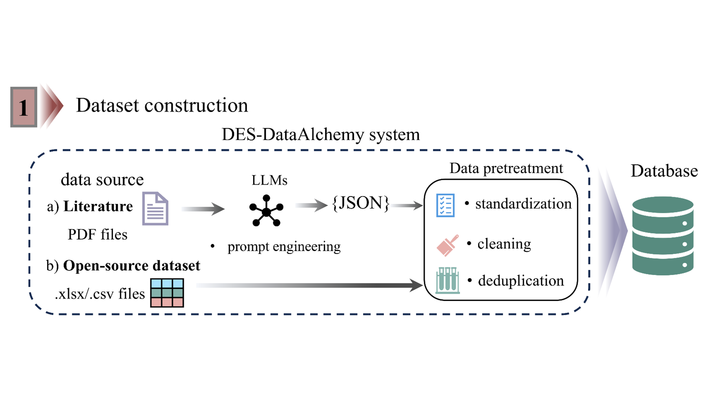

<div align="center">
  👋 Hi, everyone!
    <br>
    We are <b>BEM Lab, Westlake University.</b>
</div>

<p align="center">
  You can get to know us better through the following channels👇
  <br>
  <a href="https://bem.lab.westlake.edu.cn/">
    </a>
  <a href="https://www.apache.org/licenses/LICENSE-2.0">
    </a>
</p>

<div align="center">
  
</div>

# DES-DataAlchemy: From Literature and Open-Source Data to Deep Eutectic Solvent Databases

**DES-DataAlchemy** is an open-source, LLM-powered system for **constructing DES datasets**. It transforms two types of data sources — **scientific literature (PDF)** and **open-source datasets (`.xlsx`/`.csv`)** — into a structured and standardized **deep eutectic solvent (DES) database**. The entire curation workflow is automated: **PDF collection and screening → LLM-based structured extraction → standardization → cleaning → deduplication**.

The toolkit consists of two independent yet composable modules:

- **`structured_data_extraction`** — an 11-step LLM pipeline that screens PDFs, extracts DES formulations and properties (e.g., viscosity and temperature) into JSON, and exports them as clean tables.
- **`dataset_pretreatment`** — a post-processing pipeline that standardizes records, assigns canonical compound IDs and SMILES via PubChem, resolves missing values, and removes duplicates.

## Repository Structure

```text
DES-DataAlchemy/
├── structured_data_extraction/     # Stage 1: LLM-based extraction from PDFs
│   ├── configs/                    # Pipeline configs (config.yaml, unit/condition mappings)
│   ├── LLMprompt/                  # Prompts and extraction schema
│   ├── src/                        # Step 00–10 scripts and helpers
│   └── .env                        # API keys (not committed)
├── dataset_pretreatment/           # Stage 2: dataset normalization and deduplication
│   ├── configs/                    # Dataset config (property, state variable, reference)
│   └── src/                        # Step 00–02 notebooks and helpers
├── README-materials/               # Images and materials for this README
├── requirements.txt                # Python dependencies
└── README-template.md
```

## Stage 1: Structured Data Extraction

Place your PDFs in `structured_data_extraction/data/input/` and run the scripts in order:

| Step | Script | Description |
| --- | --- | --- |
| 00 | `00_rename_pdf_main.py` | Rename PDFs according to fixed rules and build the PDF pool |
| 01 | `01_as_prescreening_main.py` | Extract DES application scenarios |
| 02 | `02_si_screening_main.py` | Screen supporting information (SI) for the target property |
| 03 | `03_si_selector_main.py` | Select SI files that contain target-property data |
| 04 | `04_main_screening_main.py` | Screen main texts for the target property |
| 05 | `05_main_selector_main.py` | Select main-text PDFs that contain target-property data |
| 06 | `06_mining_pdf_main.py` | Parse selected PDFs and extract structured data |
| 07 | `07_json_filter.py` | Filter extracted JSON by target property and conditions |
| 08 | `08_visualizer_revisable.py` | Visualize and manually revise extraction results |
| 09 | `09_json_to_table_main.py` | Convert filtered JSON into Excel tables |
| 10 | `10_table_clean.py` | Clean tables and normalize units |

The extracted content is defined by [`extraction_schema.json`](./structured_data_extraction/LLMprompt/extraction_schema.json), covering DES components and molar ratios, measurement temperature, target property (viscosity by default), and application scenario.

**Models and API keys.** The pipeline uses DeepSeek, Qwen, and LandingAI. Provide your own keys in `structured_data_extraction/.env`:

```env
DEEPSEEK_API_KEY=your_key
QWEN_API_KEY=your_key
VISION_AGENT_API_KEY=your_key
```

Model names, endpoints, paths, target property, and condition variables are all configured in [`configs/config.yaml`](./structured_data_extraction/configs/config.yaml).

## Stage 2: Dataset Pretreatment

After obtaining a raw DES dataset, specify its name, target property, state variable, and reference in [`pretreatment_config.json`](./dataset_pretreatment/configs/pretreatment_config.json). Then place the dataset in `dataset_pretreatment/data/input/` and run the notebooks in order:

1. **`00_make_ids_map_table_main.ipynb`** — build an ID mapping table for unique compounds (with PubChem lookup).
2. **`01_add_ids_to_dataset.ipynb`** — attach canonical IDs, SMILES, and related descriptors to the dataset.
3. **`02_dataset_deduplicate.ipynb`** — handle missing values, assess data quality, and deduplicate records.

Outputs are written to `dataset_pretreatment/data/in_out/` and `dataset_pretreatment/data/output/`.

## Quick Start

```bash
# 1. Install dependencies
pip install -r requirements.txt

# 2. Run Stage 1 from the repository root
python structured_data_extraction/src/00_rename_pdf_main.py
# ... repeat for steps 01–10 in order

# 3. Run the Stage 2 notebooks
jupyter notebook dataset_pretreatment/src/
```

> Data directories (`data/`, `tmp_data/`) and `.env` are excluded by `.gitignore`, so raw PDFs, datasets, and credentials are never published with this repository.

## Data Availability

This repository does not distribute copyrighted PDFs or extracted datasets. Users are expected to provide their own literature corpus and to comply with the terms of the source publishers.

## Contributing

We welcome contributions to DES-DataAlchemy! If you have suggestions, bug reports, or improvements, please open an issue or submit a pull request.

## License

This project is licensed under the [Apache License, Version 2.0](https://www.apache.org/licenses/LICENSE-2.0).
